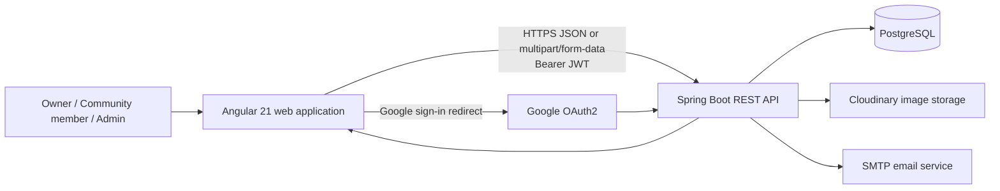
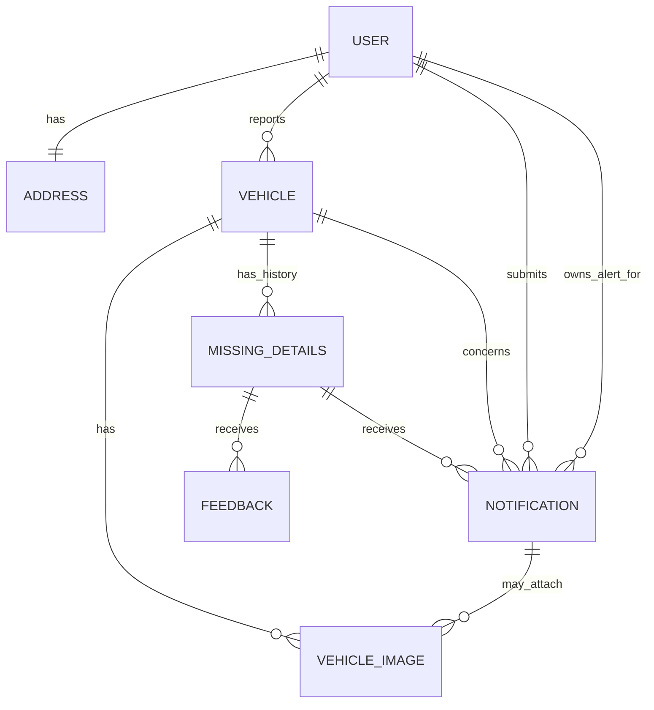

# Find My Vehicle — Project Report Context

## 1. Project identity

**Project title:** Find My Vehicle — Missing and Stolen Vehicle Reporting, Search and Community Sighting Platform

**Domain:** Public-safety/community assistance and vehicle recovery.  
**Target geography:** India; the interface and data model include Indian mobile-number and six-digit PIN-code validation, Indian states, and English/Hindi presentation.  
**Problem addressed:** When a vehicle goes missing or is stolen, owners often have no single, searchable place to publish consistent information, collect sightings, or keep the community informed. The system digitises that workflow: report a vehicle, publish details, search/filter listings, send sightings to the owner, and mark a case recovered.

**Important scope statement:** The application is an information-sharing and community-notification platform. It does not directly integrate with police/FIR, RTO, GPS hardware, emergency dispatch, insurance, or live vehicle tracking systems. Users are instructed to act safely and contact authorities where appropriate.

## 2. As-built technology stack

| Layer | Technology and purpose |
|---|---|
| Frontend | Angular 21.2 standalone components, TypeScript 5.9, SCSS |
| UI | Angular Material, Bootstrap 5, Font Awesome, ngx-toastr, SweetAlert2 |
| Client rendering | Angular SSR/hydration, Express 5 server entry, prerendered home page |
| Backend | Java 17, Spring Boot 3.3.5, Spring MVC, Spring Data JPA, Bean Validation |
| Security | Spring Security, BCrypt password hashing, JWT bearer authentication, Google OAuth2 login |
| Database | PostgreSQL; Hibernate/JPA; Flyway migration support |
| Media | Cloudinary uploads for vehicle, profile and sighting images |
| Email | Spring Mail/SMTP utility for account/profile communication |
| Documentation/operations | Spring Boot Actuator and springdoc OpenAPI/Swagger dependency |
| Deployment configuration | Netlify frontend configuration; backend endpoint configured for Render; Dockerfile present for backend |

The frontend runtime configuration points to `https://bca-finalyearproject-findmyvehicle.onrender.com/api`; local development proxies `/api` and `/oauth2` to `http://localhost:8080`.

## 3. Architecture



The frontend follows a feature-oriented structure: `features` for pages/components, `core` for API/auth/config/guards/models, `shared` for reusable layout, pipes and directives, and `layouts` for public and authentication shells. Routes are lazy-loaded standalone components. Backend follows a layered Spring architecture: controllers -> services/service implementations -> repositories -> JPA entities -> PostgreSQL, with DTOs between the web and persistence layers.

## 4. Main actors and permissions

| Actor | Main permissions |
|---|---|
| Visitor | View public home/information pages; API security permits home data and vehicle-detail/search controller routes are protected by global rule despite no method annotation. |
| Normal authenticated user | Register/login, update profile, report a missing vehicle, view own/all reports, search, submit a sighting notification, view their incoming sightings, mark own accessible reports found, submit report/app feedback. |
| Administrator | Normal-user abilities plus access to application-feedback listing and seen/unseen toggle. |

Roles stored by the backend are `NORMAL` and `ADMIN`. Spring authorities are generated as `ROLE_NORMAL` and `ROLE_ADMIN`.

## 5. Functional modules and actual user journeys

### 5.1 Authentication and identity

1. A user registers with name, email, Indian phone number, password, confirmation and consent.
2. Backend checks duplicate email, hashes the password using BCrypt, creates a local user with the default normal role, and returns a status envelope.
3. On login, the backend validates credentials and returns `userIdentity` containing user ID, email, name, role and a JWT.
4. Angular stores this identity and token in browser local storage. Its HTTP interceptor attaches `Authorization: Bearer <token>` to outgoing calls.
5. Google OAuth is also supported. Spring redirects successful OAuth users to the frontend social callback with token/identity parameters; the callback stores them for later authenticated calls.
6. Auth and admin route guards manage the member area; guests are redirected to login with a return URL.
7. Authenticated users can change their password. Profile changes trigger a confirmation email.

### 5.2 Missing-vehicle report creation

The report form gathers registration number, company, model, vehicle type, colour, chassis/engine numbers, owner name/email/mobile, missing date/time, address, city, district, state, country, PIN code, reward and description. It validates required fields, 6–15 alphanumeric/hyphen/space registration values, a 10-digit mobile number, a 6-digit PIN, valid email and a minimum five-character description.

Angular builds `multipart/form-data`: a JSON `vehicle` part plus zero or more `imageFile` parts. The backend either reuses an existing vehicle with the same case-insensitive registration number or creates a new vehicle, appends a new missing-detail history record, marks it `MISSING`, uploads images to Cloudinary and persists image URLs and relationships.

### 5.3 Discovery, detail and filtering

Search supports registration number, model, missing city and PIN code. Server-side results are paginated (default page 0, size 10; maximum 100). The dashboard has views for vehicles reported by the current user and all reported vehicles. A detail page brings vehicle data, report history, photographs and report status together. The home dashboard is API-driven and includes a header, dynamic statistics and recent missing listings.

### 5.4 Sighting notification and recovery

A community member can send a sighting for a selected registration number and missing-report ID. A sighting includes seen area, seen date/time, optional live map link, explanatory message and optional image. Backend verifies that the report belongs to the vehicle, records the sender and vehicle owner, uploads the optional image, and makes the notification visible to the owner. The owner can list notifications and set `seen` to `Y` or `N`. A missing detail can be marked `FOUND`, with a found date and status update.

### 5.5 Feedback and administration

Report feedback includes rating and comment attached to a missing report. Application feedback includes rating/comment, is attributed to the authenticated submitter and is initially unread. Administrators can page through application feedback and toggle seen status; all feedback can be paged for the dashboard.

### 5.6 Experience and supporting features

Public pages include Home, How It Works, About and Contact. The home UI offers bilingual English/Hindi text via a translation pipe, dark/light theme support, responsive desktop/mobile navigation, scroll-reveal/count-up effects, SEO route metadata, sitemap/robots files and responsive image assets. Member pages include dashboard, reports, vehicles, notifications, feedback, help/support and settings.

## 6. Backend REST API catalogue

Unless stated otherwise, responses use a wrapper conceptually shaped as `{ status: { status, message }, data }`. Paging uses Spring `Page` data (`content`, page/size/total fields).

| Method | Endpoint | Auth | Purpose |
|---|---|---|---|
| POST | `/api/auth/register` | Public | Create local account |
| POST | `/api/auth/login` | Public | Authenticate and obtain identity/JWT |
| POST | `/api/auth/change-password` | Authenticated | Change password |
| GET | `/oauth2/authorization/google` | Public | Start Google OAuth2 |
| GET | `/api/home/dashboard-data` | Public | Home header, statistics, recent vehicles |
| GET | `/api/home/refresh` | Public | Refresh home dashboard data |
| GET | `/api/dashboard` | Authenticated | Current-user dashboard summary |
| GET | `/api/profile/{id}` | Authenticated by global rule | Get profile by user ID |
| POST | `/api/profile/create` | Normal/Admin | Create/update profile with optional image |
| POST | `/api/reportMissingVehicle` | Normal/Admin | Submit multipart missing-vehicle report |
| GET | `/api/vehicle/{regNumber}` | Authenticated by global rule | Vehicle detail by registration number |
| GET | `/api/vehicles/{regNo}/missing-details/{missingDetailsId}` | Authenticated by global rule | Vehicle plus one missing report |
| PUT | `/api/missing-details/{missingDetailsId}/found` | Normal/Admin | Mark report found |
| GET | `/api/vehicles/reported-by-me` | Normal/Admin | Own vehicle reports with filters/paging |
| GET | `/api/vehicles/reported-all` | Normal/Admin | All reports, optional status/filter/paging |
| GET | `/api/vehicles/search` | Authenticated by global rule | Search/filter missing vehicles |
| POST | `/api/notifications` | Authenticated by global rule | Create JSON or multipart sighting notification |
| GET | `/api/notifications` | Authenticated by global rule | Current owner’s notifications |
| PATCH | `/api/notifications/{id}/seen?seen=Y|N` | Authenticated by global rule | Change notification seen state |
| POST | `/api/feedbacks` | Authenticated by global rule | Submit feedback about a missing report |
| GET | `/api/feedbacks` | Authenticated by global rule | Page feedback dashboard data |
| POST | `/api/app-feedbacks` | Authenticated by global rule | Submit application feedback |
| GET | `/api/app-feedbacks` | Admin | Page application feedback |
| PATCH | `/api/app-feedbacks/{id}/seen` | Admin | Toggle application-feedback seen state |

## 7. Data model / ERD



| Entity/table | Principal fields | Notes |
|---|---|---|
| `User` / `users` | id, name, unique email, password, provider, providerId, emailVerified, phoneNumber, role, profilePic, createdAt, lastactiveat | Implements Spring `UserDetails`; local or Google provider; owns a one-to-one address. |
| `Address` / `tbl_address` | addressLine1/2, city, state, pinCode, country, audit fields | Attached to one user. |
| `Vehicle` / `tbl_vehicle` | registration number (unique), chassis number (unique), engine number, owner contact, colour, type, company, model, status, reporter, audit fields | One reporting user; one-to-many images and missing-detail records. |
| `MissingDetails` / `tbl_missing_details` | missing/found dates, time, country/state/district/city/PIN, address, description, reward, status, audit fields | Historical incident/report record for a vehicle. |
| `VehicleImage` / `tbl_vehicle_images` | URL, vehicle FK or notification FK, audit fields | Stores Cloudinary URLs; migration allows null vehicle FK so notification images are possible. |
| `Notification` / `tbl_notification` | seenArea, seenAt, liveMapLink, message, owner-read state, notifier, owner, vehicle, missing detail | Community sighting/lead. |
| `Feedback` / `tbl_feedback` | rating, comments, missing-detail FK, audit fields | Feedback about a missing report. |
| `AppFeedback` / `tbl_app_feedback` | rating, comments, seen, seenBy, feedbackGivenBy, audit fields | Application-level feedback. |
| `HomeDashData`, `Statistics` | home heading/content and statistical values | Supports API-driven landing-page information. |

### Important enums

`UserRole`: NORMAL, ADMIN.  `AuthProvider`: LOCAL plus social-provider values.  `VehicleStatus`: MISSING, FOUND.  Other controlled vocabularies include `VehicleType`, `VehicleCompany`, `State`, `Country`, and `FuelType` (fuel type is defined but not evident in the current vehicle entity/form path).

## 8. Security and non-functional design

- Passwords are encoded with BCrypt.
- JWT is generated on successful local/social authentication. A `OncePerRequestFilter` reads Bearer tokens, validates them and places the user in Spring Security context.
- The backend uses method security for selected normal/admin operations and an allow-list in the global filter chain. All paths other than auth, OAuth, home, Swagger/image/temp are globally authenticated.
- Multipart limits: 10 MB per file and 50 MB per request.
- JPA audit fields populate created/modified timestamps and acting user email from the security context.
- API pagination is constrained to 1–100 items per request.
- Frontend uses SSR/hydration and lazy routes for performance. Production Angular budgets are 1 MB warning/1.2 MB error for initial bundle and 16/20 KB for component styles.
- A production Netlify redirect forwards API/OAuth requests to the Render backend; Angular output hashing supports cache safety.

## 9. Report-ready requirements

### Functional requirements

FR1 user registration; FR2 login/logout; FR3 Google sign-in; FR4 password change; FR5 profile management; FR6 report a missing vehicle with photographs; FR7 browse/search/filter/paginate reports; FR8 show vehicle and report details; FR9 mark a report recovered; FR10 submit a sighting with location/time/message/photo; FR11 owner notification inbox and read-state change; FR12 submit report feedback; FR13 submit app feedback; FR14 administrator review of app feedback; FR15 responsive bilingual/theme-aware public and member UI.

### Non-functional requirements

NFR1 confidentiality/integrity through authentication, roles and password hashing; NFR2 usability through responsive Material/Bootstrap UI and validation; NFR3 performance through paging, lazy loading, SSR and optimized production build; NFR4 maintainability through layered backend and feature-based frontend; NFR5 portability through browser SPA/SSR, Java 17 and PostgreSQL; NFR6 availability through cloud deployment configuration; NFR7 media scalability via Cloudinary; NFR8 input validation and consistent API status envelopes.

## 10. Suggested 100–120 page report plan

| Chapter | Suggested pages | What to include |
|---|---:|---|
| Front matter | 8–10 | Certificate, declaration, acknowledgement, abstract, index, figures/tables, abbreviations |
| 1. Introduction | 8–10 | Background, problem, objectives, scope, stakeholders, limitations, methodology |
| 2. Literature survey | 10–12 | Vehicle theft context, existing portals/apps, web security, community reporting; cite credible sources |
| 3. Requirement analysis | 12–14 | Actors, functional/non-functional requirements, use cases, feasibility, risk analysis |
| 4. System design | 16–18 | Architecture, DFD context/level 1, use-case, ERD, class/sequence/activity diagrams, database dictionary, UI wireframes |
| 5. Implementation | 18–20 | Angular modules/components, API/DTO/service layers, security, uploads, database, selected code explanations/screenshots |
| 6. Testing and results | 10–12 | Test strategy, test cases, validation/error scenarios, screenshots, build/test evidence, limitations |
| 7. Deployment, security and maintenance | 6–8 | Environments, Netlify/Render, backup/logging, security controls and remediation roadmap |
| 8. Conclusion and future work | 3–4 | Achievement versus objectives, roadmap |
| References and appendices | 10–12 | API specification, selected source listings, questionnaire, screenshots, test data, user manual |

Do not invent statistics such as recovery rate, active user count, crime reduction, police partnerships, or user-study results. The landing page currently contains presentation statistics, but they should be labelled demo/illustrative unless backed by database records and evidence.

## 11. Diagrams to prepare

1. Context DFD: owner/community/admin -> Find My Vehicle -> database/cloud image/email/Google OAuth.
2. Level-1 DFD: authentication, profile, vehicle reporting, search, notification, feedback and admin processes.
3. Use-case diagram using the three actors above.
4. ER diagram based exactly on Section 7.
5. Sequence diagram: reporter submits vehicle + photos; app sends multipart request; backend authenticates, uploads images, persists, returns status.
6. Sequence diagram: community member submits a sighting; owner retrieves and marks it read.
7. Deployment diagram: browser -> Netlify Angular app -> Render Spring API -> PostgreSQL/Cloudinary/SMTP/Google.
8. Activity diagram: report lifecycle `MISSING -> searched/viewed -> sighting notification -> FOUND`.

## 12. As-built caveats and improvement backlog

These are useful for the “limitations/future work/security review” sections; they should not be hidden.

1. `clearAuthOnHomeGuard` clears browser authentication when the home route is activated. This can unexpectedly log out a signed-in user who visits `/`.
2. The FAQ copy says visitors can search without an account, but the frontend `/search` route has `authGuard`, and backend global security requires authentication for `/api/vehicles/search`. Align requirements, UI copy and authorization policy.
3. Google OAuth redirects JWT and identity values in a URL query string. Use a short-lived one-time authorization code or secure HttpOnly/SameSite cookie approach instead.
4. JWT is stored in `localStorage`, which is exposed to injected browser scripts. Consider short-lived access tokens, refresh-token rotation and HttpOnly secure cookies after a threat-model review.
5. CORS allows all origins. Restrict production CORS to known frontend domains and explicitly set allowed headers/credentials policy.
6. Development configuration contains sensitive credentials/secrets. Treat them as exposed: revoke/rotate them, remove from Git history if applicable, use environment variables or a secret manager, and keep only safe examples in source control. This document intentionally does not reproduce any secret.
7. Server configuration uses `server.post` rather than Spring Boot’s `server.port`; default port 8080 will be used unless corrected.
8. Several endpoint authorization decisions rely on the global filter rather than explicit method annotations. Make the public/private API contract unambiguous and add ownership checks: for example, only the report owner or admin should mark a report found.
9. Add automated unit/integration/end-to-end tests. The visible Angular unit test still expects the starter title text and is likely stale.
10. Add rate limiting, audit/event logging, content/image moderation, image type validation/virus scanning, privacy masking for owner contact details, database backup/restore procedures and monitoring alerts before production-scale use.
11. Database schema evolution uses `ddl-auto: update` while Flyway is present. Prefer managed versioned migrations and production `validate`/`none` over automatic schema mutation.

## 13. Reusable prompt for future ChatGPT research

```text
I am writing a BCA final-year project report (100–120 pages) for “Find My Vehicle: Missing and Stolen Vehicle Reporting, Search and Community Sighting Platform.” Treat the following as the verified as-built project context, and do not claim features beyond it.

It is a full-stack web app for India. Frontend: Angular 21 standalone components, TypeScript, SCSS, Angular Material, Bootstrap, SSR/hydration, lazy routes, bilingual English/Hindi UI, responsive navigation, theme preference, SEO metadata. Backend: Java 17, Spring Boot 3.3.5, Spring Security, JWT, Google OAuth2, Spring Data JPA/Hibernate, PostgreSQL, Flyway, Cloudinary uploads, SMTP email, OpenAPI dependency. The deployed frontend routes API calls to a Render-hosted backend and local development uses port 8080.

Actors: visitor, normal authenticated user, administrator. Normal users can register/login, edit profile, report missing vehicles with photos, search/filter/paginate vehicle reports, view details, send a sighting notification, view incoming notifications, mark reports found, and submit report/app feedback. Admins also review/toggle application-feedback status. The system is an information-sharing/community platform, NOT police/FIR/RTO/GPS/live tracking/insurance integration.

Core tables/entities: User, Address, Vehicle, MissingDetails, VehicleImage, Notification, Feedback, AppFeedback, HomeDashData and Statistics. A user reports many vehicles; vehicle has many incident records/images; an incident gets many notifications/feedback records; notifications connect a notifier, vehicle owner, vehicle, incident and optional image. Main lifecycle is MISSING -> public/community discovery -> sighting notification -> FOUND.

Important data: Vehicle stores unique registration/chassis numbers, model/company/type/colour, owner contact and status. MissingDetails stores date/time/location/address/description/reward/status. Notification stores seen area/time, optional map link/message/image, sender and owner-read state. Roles: NORMAL and ADMIN. Status: MISSING/FOUND.

Security as implemented: BCrypt, JWT bearer token filter, Spring method/global security. Mention limitations honestly: token is stored in local storage; OAuth token appears in redirect query parameters; CORS is wildcard; development secrets must be rotated/removed; home navigation clears client auth; FAQ’s public-search claim conflicts with route/API authentication; server config typo uses server.post; authorization/ownership checks and testing should be strengthened.

Please help me write [STATE THE REQUEST]. Use an academic BCA report tone, make diagrams/requirements consistent with the context, distinguish “implemented” from “future work,” avoid fabricated metrics, and provide citations only from authoritative/reliable sources when research is requested.
```

## 14. Evidence and repository locations

- Frontend routes/auth/API client: `src/app/app.routes.ts`, `src/app/core/services`, `src/app/core/guards`, `src/app/core/interceptors`.
- Frontend report form: `src/app/features/vehicle-reports/pages/report-missing`.
- Backend controllers: `src/main/java/com/pratima/bca/findmyvehicle/controller`.
- Backend persistence model: `src/main/java/com/pratima/bca/findmyvehicle/entity`.
- Business services: `src/main/java/com/pratima/bca/findmyvehicle/serviceImpl`.
- Authentication/security: `src/main/java/com/pratima/bca/findmyvehicle/security` and `util/JwtUtils.java`.
- Dependency manifests: frontend `package.json`; backend `pom.xml`.
- Deployment/configuration: frontend `netlify.toml`, `proxy.conf.json`, `public/config/app-config.json`; backend `Dockerfile` and `src/main/resources`.

